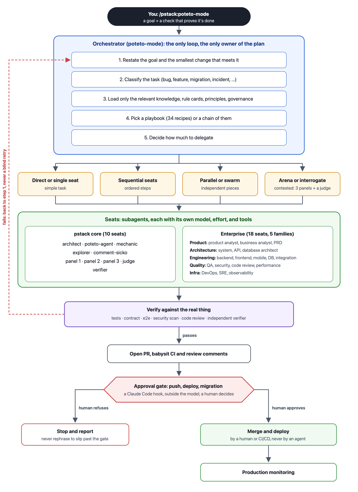

# estack

My agentic engineering harness for Claude Code. It starts from
[pstack](https://github.com/cursor/plugins/tree/main/pstack) by Lauren Tan, a
disciplined workflow system for coding agents, and adds an enterprise SDLC layer
on top: specialist roles, governance, business-rule cards, and approval gates on
risky commands.

The short version: you give it a goal and a way to check it's done. One
orchestrator picks the right playbook, hands pieces of work to specialist
subagents, makes independent reviewers check the result, and stops for a human
before anything that touches shared systems (push, deploy, migration).

## Install

Inside a Claude Code session:

```text
/plugin marketplace add edwardsean/ESTACK
/plugin install estack@estack
/estack:setup-models          # pick a model and effort for each seat, once
```

In a repository where you want the enterprise layer (gates, knowledge index,
governance policy), run once:

```text
/estack:setup
```

Then start real work:

```text
/estack:poteto-mode add CSV export to the orders page. done means the export
test passes and the file opens in Excel.
```

## How it works



### The pieces, in plain words

**One orchestrator.** `/estack:poteto-mode` is the brain. It reads your goal,
classifies the task, and matches it to a playbook, a written recipe for that kind
of work (bug fix, feature, refactor, migration, incident, release, and so on).
The enterprise layer runs inside this same loop, so there is never a second
planner arguing about what happens next.

**Playbooks.** 34 of them: 22 from pstack and 12 enterprise ones (requirements
analysis, PRD creation, architecture design and review, database migration, API
contract design, security assessment, enterprise feature and bug fix,
integration testing, release management, production incident). Composition
chains string several together for bigger jobs, and are only as long as the task
needs.

**Seats.** A seat is a subagent with one job, its own tools, and its own model
and effort. Ten come from pstack (architect, three review panels, judge,
verifier, explorer, mechanic, comment pass, general worker). Eighteen enterprise
seats sit in five families:

| Family | Seats |
|---|---|
| Product and requirements | product analyst, business analyst, PRD agent |
| Architecture and design | system architect, API architect, database architect |
| Engineering | backend, frontend, mobile, database, integration engineer |
| Quality and governance | QA, security, code reviewer, performance engineer |
| Infra and operations | DevOps, SRE, observability |

Two rules hold for every seat: a seat never runs the workflow and never approves
its own work, and the orchestrator alone decides what runs in parallel.
Reviewing seats can't edit files, and engineering seats work in their own git
worktree.

**Independent checking.** Nothing is "done" because it compiles. Arena runs three
independent attempts on different models and a judge scores them. Interrogate
runs three adversarial reviewers. A separate verifier re-checks every claimed fix
against the real artifact. Failures loop back to implementation, not a blind
retry.

**Knowledge and rules, scoped.** Per repository, `/estack:setup`
writes a knowledge index (pointers to architecture docs, service catalog, ADRs,
schemas), a governance policy (which change types need architecture, security, or
DBA review), and `/estack:prd-rules` turns a PRD into business-rule cards. Each
subagent only gets the slice relevant to its job.

**Approval gates.** Claude Code hooks sit outside the model. In an opted-in repo,
a `git push`, deploy, or migration command makes Claude Code ask you first,
approvals are logged, and a seat that ran a gated command without asking can't
finish cleanly. In a repo that didn't opt in, the hooks do nothing.

**24 principles.** Short rules the agent cites when they change a decision: fix
root causes, prove it works, subtract before you add, make illegal states
unrepresentable, build the tool instead of doing it by hand, and so on.

## Engine

A small state engine tracks tasks and steps so the orchestrator cannot claim
progress it has not earned. It ships bundled inside the plugin as
`engine/estack.mjs` and needs Node 22.5 or newer (it uses `node:sqlite`).

**What it stores, and where.** State lives in `.estack/state.db` in the main
checkout (worktrees share it). A repository is opted in only when
`.estack/policy.yaml` exists; `/estack:setup` runs `estack init` to create it,
along with `.estack/brief.md`, which the owner fills in. Every change appends a
row to an events log.

**MCP tools.** The plugin registers an `estack` MCP server (`core/.mcp.json`)
that exposes four tools: `start_task`, `status`, `complete_step` and `run_check`. For `test` and `verify` the engine runs the command fixed in
`policy.yaml` itself and never trusts evidence described in words.

**CLI.** Run `npm link` once in the estack clone to get `estack` on your PATH,
or call `node --no-warnings adapters/claude-code/engine/estack.mjs`. Commands:
`init`, `status [--json]`, `run --task <id> --step <test|verify>`, `skip`,
`cancel`, `override`, and `mcp`.

**Owner-only commands.** `skip`, `cancel` and `override` refuse to run inside a
Claude Code session (when `CLAUDECODE=1`). Run them from a normal terminal.

## Repository layout

```text
estack/
  .claude-plugin/marketplace.json   the "estack" marketplace, points at adapters/claude-code/
  core/                             the harness content: you edit this
  adapters/claude-code/             the Claude Code plugin, generated from core/ (what you install)
  adapters/*.ts                     the generator and its tests
  pstack-qoder/                     the Qoder edition, kept for reference
  upstream/pstack/                  pinned upstream pstack 0.15.43, kept for reference
  upstream/claude-code/             upstream's own Claude Code edition, kept for reference
  docs/                             diagrams, design docs and plans
```

**Edit `core/`, never `adapters/claude-code/`.** The generator copies `core/` into
each adapter, filling in that coding agent's names and paths, so one set of content
can serve several coding agents. Claude Code is the first adapter.


Rebuild and check everything:

```bash
npm install
npm run build:claude          # regenerate adapters/claude-code/ from core/
npm test                      # the generator's tests
(cd adapters/claude-code && bash scripts/selftest.sh)
```

The self-test runs static conformance, 46 hook-gate assertions, a hook smoke test,
`claude plugin validate`, and fails if `adapters/claude-code/` differs from what
`core/` generates.

## More detail

- [adapters/claude-code/README.md](adapters/claude-code/README.md): every command, seat, and default model
- [core/docs/ENTERPRISE-ARCHITECTURE.md](core/docs/ENTERPRISE-ARCHITECTURE.md): the six-layer enterprise design
- [core/docs/MODEL-ROUTING.md](core/docs/MODEL-ROUTING.md): how each seat gets its model and effort
- [core/COMPATIBILITY.md](core/COMPATIBILITY.md): what works, what differs from upstream, what's unproven
- [core/docs/guide/](core/docs/guide/README.md): the 10-page user guide
- [docs/superpowers/specs/2026-11-25-estack-engine-design.md](docs/superpowers/specs/2026-11-25-estack-engine-design.md): the plan for the workflow engine, code map and handover

## Credits

pstack is by Lauren Tan, MIT licensed, from
[cursor/plugins](https://github.com/cursor/plugins). Each edition carries the
upstream `LICENSE` unchanged. estack is a personal fork and is not endorsed by or
affiliated with the upstream author.
