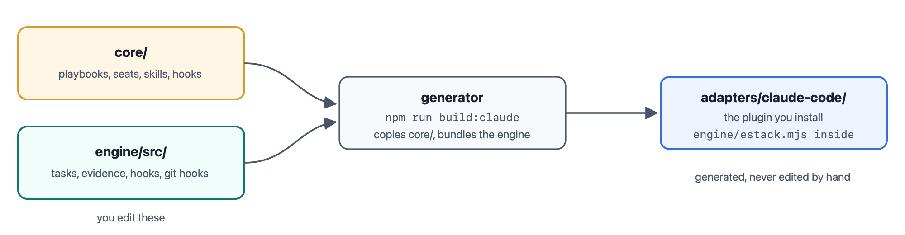

# estack

My agentic engineering harness for Claude Code. It starts from
[pstack](https://github.com/cursor/plugins/tree/main/pstack) by Lauren Tan, a
disciplined workflow system for coding agents, and adds an enterprise SDLC layer
on top: specialist roles, governance, business-rule cards, and approval gates on
risky commands.

The short version: you give it a goal and a way to check it's done. One
orchestrator picks the right playbook, hands pieces of work to specialist
subagents, makes independent reviewers check the result, and stops for a human
before anything that touches shared systems (push, deploy, migration).

What makes it a harness rather than a set of instructions: a small **engine**
outside the model records every task, its required steps and the evidence for
each step, and **hooks** check that engine before every code edit, risky command,
agent commit, push and end of turn. An agent can't skip a step or claim a test
passed: the engine runs the tests itself, and the hooks block what isn't proven.

## Install

Inside a Claude Code session:

```text
/plugin marketplace add edwardsean/ESTACK
/plugin install estack@estack
/estack:setup-models          # pick a model and effort for each seat, once
```

You need Node 22.5 or newer (the engine uses `node:sqlite`). The code map
needs [Graphify](https://github.com/Graphify-Labs/graphify), which is optional:
`uv tool install "graphifyy>=0.9.121,<0.10"`.

In a repository where you want the engine and its guards (plus the knowledge
index and governance policy), run once:

```text
/estack:setup
```

Then commit the policy yourself, from your own terminal. Agents aren't allowed
to commit `.estack/policy.yaml`, so the git hook refuses if they try:

```bash
git add .estack && git commit -m "Add estack policy"
```

Then start real work:

```text
/estack:poteto-mode add CSV export to the orders page. done means the export
test passes and the file opens in Excel.
```

## How it works


### The pieces, in plain words

**One orchestrator.** `/estack:poteto-mode` is the brain. It reads your goal,
classifies the task, and matches it to a playbook, a written recipe for that kind
of work (bug fix, feature, refactor, migration, incident, release, and so on).
The enterprise layer runs inside this same loop, so there is never a second
planner arguing about what happens next.

**Playbooks.** 34 of them: 22 from pstack and 12 enterprise ones (requirements
analysis, PRD creation, architecture design and review, database migration, API
contract design, security assessment, enterprise feature and bug fix,
integration testing, release management, production incident). Composition
chains string several together for bigger jobs, and are only as long as the task
needs.

**Seats.** A seat is a subagent with one job, its own tools, and its own model
and effort. Ten come from pstack (architect, three review panels, judge,
verifier, explorer, mechanic, comment pass, general worker). Eighteen enterprise
seats sit in five families:

| Family | Seats |
|---|---|
| Product and requirements | product analyst, business analyst, PRD agent |
| Architecture and design | system architect, API architect, database architect |
| Engineering | backend, frontend, mobile, database, integration engineer |
| Quality and governance | QA, security, code reviewer, performance engineer |
| Infra and operations | DevOps, SRE, observability |

Two rules hold for every seat: a seat never runs the workflow and never approves
its own work, and the orchestrator alone decides what runs in parallel.
Reviewing seats can't edit files, and engineering seats work in their own git
worktree.

**Independent checking.** Nothing is "done" because it compiles. Arena runs three
independent attempts on different models and a judge scores them. Interrogate
runs three adversarial reviewers. A separate verifier re-checks every claimed fix
against the real artifact. Failures loop back to implementation, not a blind
retry.

**Knowledge and rules, scoped.** Per repository, `/estack:setup`
writes a knowledge index (pointers to architecture docs, service catalog, ADRs,
schemas), a governance policy (which change types need architecture, security, or
DBA review), and `/estack:prd-rules` turns a PRD into business-rule cards. Each
subagent only gets the slice relevant to its job.

**The engine and its guards.** The green panel in the diagram. Before any code
is written the orchestrator calls `start_task`, and the engine records the task
and the steps its type requires (for a feature: plan, reuse check, implement,
test, verify, review, PR). Each step needs real proof: a commit made after the
task started, a test run the engine did itself, a review from a different agent.
Claude Code hooks and git hooks, outside the model, check the engine at every
edit, risky command, agent commit, push and end of turn: no task means no code
edit, no verify evidence means no push, and pushes, merges, deploys and
migrations wait for your approval. Workers never push. In a repo that didn't opt
in, the hooks do nothing. See [Engine](#engine) and [Hooks](#hooks).

**The code map.** If Graphify is installed, `/estack:setup` builds a map of
your code's files, functions and who calls what. An agent that starts a task
with an `area` gets that part of the map, and `find_existing`, `context_for` and
`who_uses` search it, so a reuse check rests on a real search. A copy of existing
code that slips in holds back verify until it is removed or a reviewer dismisses
it. The map leaves out `.estack/` and anything in `code_map.exclude` in the
policy (setup suggests build output, vendored and generated code). To turn it
off, set up with `--code-map off` or set `code_map.enabled: false` in
`.estack/policy.yaml`.

**24 principles.** Short rules the agent cites when they change a decision: fix
root causes, prove it works, subtract before you add, make illegal states
unrepresentable, build the tool instead of doing it by hand, and so on.

## Engine

A small state engine tracks tasks and steps so the orchestrator cannot claim
progress it has not earned. It ships bundled inside the plugin as
`engine/estack.mjs` and needs Node 22.5 or newer (it uses `node:sqlite`).

**What it stores, and where.** State lives in `.estack/state.db` in the main
checkout (worktrees share it). A repository is opted in only when
`.estack/policy.yaml` exists; `/estack:setup` runs `estack init` to create it,
along with `.estack/brief.md`, which the owner fills in. Every change appends a
row to an events log.

**MCP tools.** The plugin registers an `estack` MCP server (`core/.mcp.json`)
that exposes ten tools: `start_task`, `status`, `complete_step`,
`run_check`, `handover` and `resume`, and for the code map `context_for`,
`find_existing`, `who_uses` and `dismiss_duplicate`. For `test` and `verify` the engine runs the command fixed in
`policy.yaml` itself, in the task's worktree, and never trusts evidence
described in words.

**CLI.** Run `npm link` once in the estack clone to get `estack` on your PATH,
or call `node --no-warnings adapters/claude-code/engine/estack.mjs`. Commands:
`init`, `status [--json]`, `handovers`, `run --task <id> --step <test|verify>`, `skip`,
`cancel`, `override`, `map update|status|suggest` (build the code map, show it,
suggest what to exclude), and `mcp`, plus `git-hook` and `map-hook`, which the
installed git hooks call. Exit codes: 0 on success, 1 for an engine or
internal error, 2 for a usage error, and 3 when `run` ran the check but it
failed.

**Owner-only commands.** `skip`, `cancel` and `override` refuse to run inside
an agent session (when `CLAUDECODE=1`), as a guard against accidental use; it
is not a security boundary. Run them from a normal terminal.

### Handover

Long sessions fill their context. The engine measures it and, past
`handover.threshold` (default 0.5 of `handover.window_tokens`, default 200000),
suggests a handover. Set `window_tokens: 1000000` in `.estack/policy.yaml` on a
1M-token model. If the context grows past `window_tokens` anyway, the engine
measures it against 1000000 instead.

1. Finish the step you are on and let the workers report.
2. Run `/estack:handover`. It records the goal, the remaining plan, decisions,
   open questions, and the state of every open task.
3. Run `/clear`. With one handover waiting, the new session is told to load it and
   does so on its own. If several are waiting, it lists each one by id (`#12
   session from 1a2b3c4d 5m ago goal: ...`) and asks you which; the session then
   resumes that one with `handover_id`. You can also run `/estack:resume <task>`.
   It re-reads the files before it changes anything.

A handover is not loaded on its own when its session logged any activity in
the last 10 minutes after saving it: that session may still be running, for
example a second CTO session in another terminal. The new session lists it
with "it may still be running" and asks you first. A session handover whose
session has no open task left is not offered at all when it has no plan left,
when its session kept working after saving it, or when it is more than 24 hours
old: that is finished or abandoned work.

Handovers stay in the worktree they were saved from. A new session is only
offered, and a plain resume only takes, a handover saved from its own
worktree, so a session for one feature never picks up another feature's work.
It is told when handovers are waiting in other worktrees; `estack handovers`
lists every one with its worktree, and you can resume any of them by id.

Use `/compact` only when the conversation itself must be kept. The engine saves
state before compaction and restores it afterward. A handover from the CTO
moves every task bound to the old session to the new session, including tasks
started after the handover was saved. `/estack:resume` picks one up by hand,
and `estack handovers` lists what is waiting, each line starting with its id.

## Hooks

Every hook goes through `hooks/scripts/estack-hook.sh`, which runs the bundled engine. Without `.estack/policy.yaml` the script exits at once without starting Node, and with the code map off it does the same for `Read` and `Grep`. In an opted-in repository:

| Hook | What it does |
|---|---|
| `PreToolUse` (edit tools, `Bash`, estack MCP tools) | Denies an edit with no open task, an edit to a protected path, a push without verify evidence, any `ask` action from a worker, and the hard-coded set (touching `.estack/state.db`, `estack skip`/`cancel`/`override`, `--no-verify` or `git commit -n`, `core.hooksPath` in any case, mentioning `CLAUDECODE`). Asks the owner for push, merge, deploy and migration. Fails closed if the engine errors |
| `PreToolUse` (`Read`, `Grep`) | With the code map on, "look at the map first": an agent on a task whose `reuse_check` is not done is denied once on its first read of mapped code, until it has run a code-map tool (`context_for`, `find_existing` or `who_uses`) itself. The `reuse_check` step itself still needs a `context_for` or `find_existing` search. Fails open: any error lets the read through |
| `PostToolUse` (`Bash`) | Records an approved command in the events log. Never blocks |
| `SessionStart` | Tells the session the repository is opted in and lists open tasks. On every start that is not a compaction (startup, `/clear`, resume) it hints at waiting handovers; it tells the session to load one on its own only when exactly one is waiting for its own worktree and that handover's session has not been active in the last 10 minutes, and otherwise lists them by id and asks the owner. After a compaction it restores the state saved for that compaction, or shows the session's open tasks as they are now |
| `UserPromptSubmit` | Every prompt: reminds the session of its task's next step. Once per task step, and only past `handover.threshold` of the context window: suggests a handover |
| `PreCompact` | Saves a session handover before the conversation is compacted, only when the main session (not a worker) has open tasks. Never blocks |
| `Stop` | Blocks once when a session task has commits made after the task started but no evidence on its implement or fix step |
| `SubagentStop` | The same check for the worker's own tasks, and also blocks when implement or fix is settled but the test step is not |

`estack init` also installs git `pre-commit` and `pre-push` hooks that run the same engine against agents that run git (the owner's own terminal is never checked), unless `core.hooksPath` is set. Its four map hooks (`post-commit`, `post-checkout`, `post-merge`, `post-rewrite`) run a background Graphify build on every commit and checkout, the owner's own included, so the code map stays current; they never make git wait or fail, and do nothing with the map off. If the recorded engine path disappears after a plugin update, the hooks fall back to the newest copy in the plugin cache.

An owner override (`estack override git_push --reason ...`, run in the owner's terminal) lasts 30 minutes and is used up by the git `pre-push` hook when the push actually runs. The `Bash` gate only checks that one exists and then asks, so declining the prompt does not spend it.

What the gates do not catch:

- Shell writes (`echo > file`, `sed -i`, `tee`, a script) are not seen by the edit gate, which only watches the edit tools. The git `pre-commit` hook still checks what an agent commits.
- `gh pr create` counts as a push: it needs verify evidence and the owner's approval like `git push`.
- The hard-coded denials match text, so they also catch harmless mentions, such as grepping for `--no-verify` or printing `$CLAUDECODE`. Run those yourself in a terminal.
- Deploy and migration patterns match command forms (`npm run deploy`, `terraform apply`, `prisma migrate deploy`, and so on), so a deploy behind a custom script name is not asked about until you add its pattern to `policy.yaml`.

## Repository layout

```text
estack/
  .claude-plugin/marketplace.json   the "estack" marketplace, points at adapters/claude-code/
  core/                             the harness content: you edit this
  engine/                           the engine: tasks, evidence, MCP server, CLI, hooks, git hooks
  adapters/claude-code/             the Claude Code plugin, generated from core/ (what you install)
  adapters/*.ts                     the generator and its tests
  pstack-qoder/                     the Qoder edition, kept for reference
  upstream/pstack/                  pinned upstream pstack 0.15.43, kept for reference
  upstream/claude-code/             upstream's own Claude Code edition, kept for reference
  docs/                             diagrams, design docs and plans
```

**Edit `core/` and `engine/`, never `adapters/claude-code/`.** The generator copies
`core/` into each adapter, filling in that coding agent's names and paths, and
bundles the engine into one file inside it, so one set of content can serve
several coding agents. Claude Code is the first adapter.



Rebuild and check everything:

```bash
npm ci
npm run build:claude          # regenerate adapters/claude-code/ from core/ and engine/
npm test                      # generator and engine tests
(cd adapters/claude-code && bash scripts/selftest.sh)
```

The self-test runs static conformance, an engine hook smoke test,
`claude plugin validate`, and fails if `adapters/claude-code/` differs from what
`core/` generates.

## Status and roadmap

estack is being built in phases, each one usable on its own
([design](docs/superpowers/specs/2026-11-25-estack-engine-design.md)).

| Phase | What it adds | Status |
|---|---|---|
| 1 | `core/` plus a generated Claude Code plugin; renamed from pstack to estack | Done |
| 2 | The engine: tasks, required steps, evidence, MCP tools, CLI | Done |
| 3 | Hooks and git hooks that enforce the engine | Done |
| 4 | Handover: continue a task in a fresh session from recorded state | Done |
| 5 | Code map on [Graphify](https://github.com/Graphify-Labs/graphify): agents see existing code before writing new code, and reuse searches count as evidence | Done |
| 6 | Parallel workers in their own worktrees, with claims so two never build the same thing | Planned |
| 7 | A second coding agent (Cursor or OpenCode) from the same `core/` | Planned |

## More detail

- [adapters/claude-code/README.md](adapters/claude-code/README.md): every command, seat, and default model
- [core/docs/ENTERPRISE-ARCHITECTURE.md](core/docs/ENTERPRISE-ARCHITECTURE.md): the six-layer enterprise design
- [core/docs/MODEL-ROUTING.md](core/docs/MODEL-ROUTING.md): how each seat gets its model and effort
- [core/COMPATIBILITY.md](core/COMPATIBILITY.md): what works, what differs from upstream, what's unproven
- [core/docs/guide/](core/docs/guide/README.md): the 10-page user guide
- [docs/superpowers/specs/2026-11-25-estack-engine-design.md](docs/superpowers/specs/2026-11-25-estack-engine-design.md): the engine design, including the Graphify code map (amendment 1)
- [docs/superpowers/plans/](docs/superpowers/plans/): the step-by-step plan for each phase

## Credits

pstack is by Lauren Tan, MIT licensed, from
[cursor/plugins](https://github.com/cursor/plugins). Each edition carries the
upstream `LICENSE` unchanged. estack is a personal fork and is not endorsed by or
affiliated with the upstream author.
