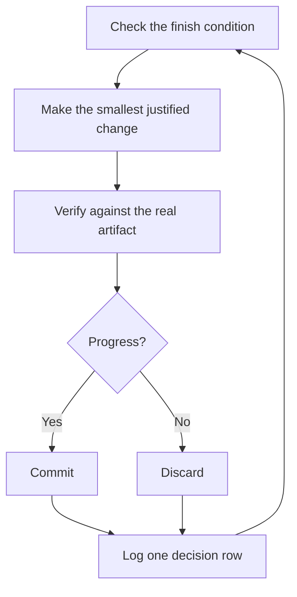

# Run long work you review later

Upstream calls this the overnight run. This is the payoff for everything before it. An agent you can trust to verify its own work is an agent you can leave alone with a hard task. What makes that safe isn't hope. It's a checkable finish condition, an isolated worktree, and a decision log you audit afterwards.


**Read this before the rest, because it is where the port loses the most.** Upstream runs this page's contract unattended, woken on a heartbeat by an editor feature that re-enters the run every hour. Qoder has no timer and no scheduled re-entry, so nothing restarts a run once the turn that started it ends. An agent cannot work while you sleep here, and any agent that tells you it will is wrong. Everything below still works as one long bounded pass that you stay reachable for, and the resume note is what makes stepping away safe. What you trade is a night of unattended iterations for one long turn with a ceiling you chose.

## Earn the trust before a long run

A long run you don't trust just produces unchecked work faster, and the mess compounds with every iteration. Before you hand one a ceiling of a few hours, check that it has earned it:

- You've done the task once by hand, or watched an agent do it, so you know what good looks like.
- The agent has the tools and signals you'd use yourself: the verification skill, the profiler, the logs.
- Every stage proves its work and can stop the line when the work misses the bar.
- You've read a few transcripts and turned the repeated failures into tools, skills, or checks.

Make a run autonomous only after all four hold. Until then, run it while you watch. In this port a run only advances inside a turn, so a long pass means one long turn rather than a night of them.

## The handoff contract

A good handoff has the goal, the finish condition, permissions, a ceiling, and an escape hatch. It doesn't need to be long:

```text
/poteto-mode im stepping away. migrate every caller to the new parser in a fresh worktree off <base>.
done means zero old callers, all parser fixtures pass, old api deleted.
keep a decision log. don't ask me before committing.
keep going until done, and stop after 25 callers or 90 minutes, whichever lands first.
if you're truly stuck, stop early and write up why plus how to resume.
```

Walk through what each line buys you:

- "im stepping away" is a session override. The agent stops asking and keeps going.
- "done means..." turns the goal into checks every iteration can run.
- "fresh worktree off `<base>`" keeps the run from colliding with anything else you have open.
- "don't ask me before committing" pre-answers the permission the agent would otherwise block on.
- The ceiling replaces upstream's hourly wake. Qoder has no timer to re-enter a run, so the pass ends when the turn ends whether you named a ceiling or not. Naming one in units the agent can count, callers migrated or minutes elapsed, is what turns that into a deliberate stop with a resume note instead of a truncation in the middle of an edit.
- The escape hatch lets it stop at a genuine dead end and write up why, which beats hours of creative goal reinterpretation.

Because you'll review this work after stepping away, `/poteto-mode` routes it through [`/figure-it-out`](../../skills/figure-it-out/SKILL.md), which designs the run's phases before any code and wires in the decision log.

To stop a run on purpose, tell the agent to pause, or that you're about to go offline or restart Qoder. The [Pause safely playbook](../../skills/poteto-mode/playbooks/pause-safely.md) finishes or backs out of the current step, commits a work-in-progress checkpoint, and writes a resume note. A fresh chat picks the work up from that note through the Session pickup playbook. Saying "keep going" never triggers a pause.

In this port the resume note matters more than it does upstream, because it is the only thing that survives. Upstream could wake the same run back up. Here the next pass is a new chat that reads the note, so a run that ends without one hands you a half-finished worktree and no way to know what was already tried.

## What one iteration does



One change, one check, one log row, every iteration. Changes that didn't help get discarded, not left to ride. A plateau means pivot, not stop, and the finish condition never quietly relaxes to declare victory.

## The audit afterwards

[`/show-me-your-work`](../../skills/show-me-your-work/SKILL.md) is what makes the run reviewable. Each row records the time, phase, decision, reason, an evidence pointer, and the result, in a TSV at `decisions.tsv` (or `.audit/<task-slug>.tsv` when several runs share a directory). It stays local by default. Commit it when the work is ambitious enough that a reviewer needs the trail to trust the result.

When you're back, ask for the run in review form:

```text
/show-me-your-work catch me up on what you did
```

Before the skill hands back its summary, it spawns the `pstack:pstack-judge` seat to read the trail and the transcript, and the reply ends with an Attention section listing what deserves your scrutiny. Every model Claude Code can run comes from one vendor, so the judge reports the model it ran on and you check it against the model that did the work. When they match, the review is a second reading rather than a second opinion, and the reply should say so. Read the Attention section first, then the log rows it points at. You're auditing decisions, not re-reading the whole run.

For a quick status instead of an audit, run [`/ketchup`](../../skills/ketchup/SKILL.md) in the chat that ran the work. It reads only, and tells you in plain words what changed since your last message, with the screenshots and small diagrams the work produced. Then it lists each call waiting on you, such as a merge, an approval, or a choice between options, with its pick, the evidence, and the risk, so you can decide from the reply alone.

## When the run holds a queue, not a task

The contract above drives one task to one finish condition. Some runs hold more, a queue of independent changes or a whole program. Two playbooks and one skill scale the same trust up. All three carry a ceiling in this port, because none of them can be woken to finish later.

[Autopilot-full](../../skills/poteto-mode/playbooks/autopilot-full.md) runs a queue of independent PRs to merged. Each PR gets one owner agent that carries it from build through merge, and no owner merges on its own verdict. A swarm of fresh verifiers checks the owner's code-ready head. A later rebase or minor fix gets one fresh verifier, and only new behavior or a large new diff calls the full swarm again. Only a clean verdict on the patch that merges authorizes the merge:

```text
/poteto-mode full autopilot on this queue. each item is independent. cap it at four PRs and two hours, then hand me a resume note.
```

[Autopilot-stack](../../skills/poteto-mode/playbooks/autopilot-stack.md) is Autopilot-full without the merge. You get verified PRs, each with its verdict, and you review and land them yourself. A PR stacks only on a PR it builds on. Pick it over Autopilot-full when you want your own eyes on the work before anything merges:

```text
/poteto-mode autopilot these five changes, but don't merge. cap the pass at two hours and i'll land whatever is verified.
```

A whole program, such as a migration across many packages, has no playbook of its own. `/poteto-mode` routes large or cross-cutting work to [`/figure-it-out`](../../skills/figure-it-out/SKILL.md), which designs one rigorous run for it:

```text
/poteto-mode migrate every package to the new store. own it until each one is converted and merged. cap this pass at three packages, then write the resume note.
```

## Run many projects in parallel

Upstream gives one coordinator agent a persistent thread per project, with its subagents running in the cloud so the work continues when your laptop is closed. Qoder has neither a persistent project thread nor cloud agents, so the equivalent here is one chat and one worktree per body of work, and the coordinator is the chat you keep returning to. Nothing continues with the laptop closed. Start your prompts to that chat with `/poteto-mode`, and the subagents it spawns follow the playbooks. Each agent it starts reads [`worker.md`](../../skills/poteto-mode/worker.md) first, so workers hold to the kickoff's bar, decide reversible calls instead of asking you, and open PRs ready for review.

A few habits help:

- Give each body of work its own chat and its own worktree, such as a feature, a migration, a perf push, or a tech-debt cleanup. Several can run side by side, limited by this machine's CPU and disk rather than by a quota.
- A chat has no shared context store that the next one reads, so context travels in the repo. Write the standing brief for a body of work into a file the workers read, instead of assuming a fresh chat remembers the last one.
- Give each PR a verification swarm before it merges, and let Autopilot-stack or Autopilot-full carry the queue.
- Ask the coordinator for a plan backed by data, and have it answer open questions with prototypes before it asks you.

One prompt can carry a whole body of work, from research through execution:

```text
/poteto-mode refactor this repo so its architecture is more agent friendly. use /correct and /architect on past commits and review comments to find the mistakes agents make most here. use /recall for context from past chats. answer open questions with prototypes instead of asking me. come back with a plan backed by real data. once i approve it, run it with autopilot-stack or autopilot-full, and ask me which.
```

## What the port cannot do here

Every run above still waits for you to start it, and in this port that is a hard limit rather than a habit to break. Upstream removes the step with scheduled and event-driven automations, and it ships a dormant automation pack for chat-hosted issue reports where one automation triages each report and another reproduces confirmed bugs. Qoder has no scheduler and no inbound webhook that can start a chat, and that pack's setup files are not part of this port, so there is nothing here to point an agent at. Do not wire up an external cron job to drive the IDE either, because nothing in this plugin was tested against that and a headless trigger has no session to run in.

The two rules that keep such a line trustworthy still transfer, and they are worth holding even when you start each stage by hand:

- Every stage can stop the line. Triage can decide the report is expected behavior, repro can fail to reproduce it, and the fixer can judge the change too risky. Each of those outcomes is useful, because it keeps bad work from reaching the next stage, where it costs more to undo.
- Every stage hands over evidence. Repro attaches screenshots and video of the broken state, and the fix attaches before-and-after proof. A human can then check that the agent fixed the right thing before reading a line of code.

Held by hand, that is a four-prompt pipeline rather than an automation. It costs you the starting, and it keeps every property that made the automated version safe.

**Pitfall:** a duration is not a finish condition. "work on this for 4 hours" gives the agent nothing to check, and you'll come back to four hours of motion instead of a result. Give the agent a predicate that can pass or fail, and a ceiling it can count.

Next: [Steer with principle names](./08-principles.md).
