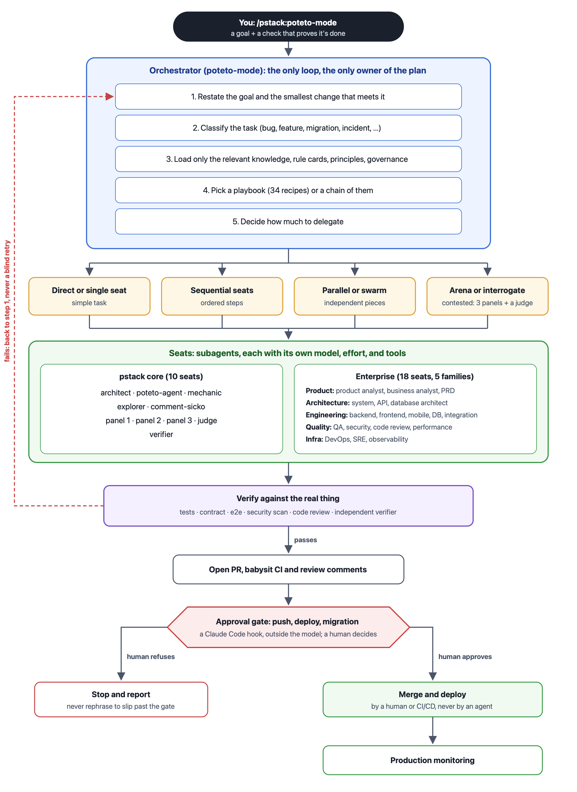

# pstack for Claude Code

The pstack engineering workflow system by Lauren Tan, as a native Claude Code
plugin. A playbook-routing orchestrator, three-seat review panels, parallel
arenas and swarms, independent verification, and 24 engineering principles,
with each seat's model and effort chosen per call.

On top of that sits an enterprise SDLC layer: a scoped knowledge index, a
governance policy that resolves into named review steps, twelve more playbooks,
eighteen specialist seats in five families, PRD-to-business-rule cards, and
opt-in approval-gate hooks on push, deploy, and migration commands. It runs
inside `/pstack:poteto-mode` rather than beside it, so there is still exactly one
orchestration loop and one owner of the plan.
[docs/ENTERPRISE-ARCHITECTURE.md](./docs/ENTERPRISE-ARCHITECTURE.md) records the
design layer by layer.

This edition was ported from the Qoder edition of pstack (which carries the
enterprise layer) by a re-runnable lever, `scripts/port-from-qoder.py`. Upstream
is Cursor pstack 0.15.43. **Read [COMPATIBILITY.md](./COMPATIBILITY.md) before
you rely on it.** The short version: Claude Code gives back several things the
Qoder edition had to give up (per-call model and effort, background subagents,
`/loop`, real manual-only skills), and one thing is still out of reach, a judge
from a different model vendor.

## How it works



The [estack README](../README.md) explains each part of this diagram in plain words.

## Install

The estack repository root is a marketplace named `estack`. Inside a Claude
Code session:

```text
/plugin marketplace add edwardsean/ESTACK
/plugin install pstack@estack
```

Or from a shell:

```bash
claude plugin marketplace add edwardsean/ESTACK
claude plugin install pstack@estack
claude plugin list            # shows pstack@estack, enabled
```

To work on a local clone instead, add the clone's root folder in place of
`edwardsean/ESTACK`. This folder is also a marketplace of its own,
`pstack-claude`, if you add it directly.

Then start a new session, or run `/reload-plugins`. Nothing changes until you
invoke a skill. Edits to a locally added marketplace take effect at the next
session start or on `/reload-plugins`.

To try it for one session without installing anything:

```bash
claude --plugin-dir ./pstack-claude     # from the estack root
```

To remove it: `claude plugin marketplace remove estack`, which also
uninstalls the plugin.

## Use it

Claude Code prefixes plugin skills and agents with the plugin name, so every
command below is `/pstack:<name>`, and every seat is `pstack:<seat>`. The bare
`/<name>` also works unless another plugin claims it.

Configure models once. It reads which models the `Agent` tool accepts, asks for
a reasoning budget, and writes `~/.claude/rules/pstack-models.md`, one
`<seat>: <model> <effort>` line per seat you changed:

```text
/pstack:setup-pstack
```

Start real work with a goal and a check that can pass or fail:

```text
/pstack:poteto-mode migrate every caller off the legacy parser. done means zero old
callers and the parser fixtures pass.
```

`/pstack:poteto-mode` matches the task to one of 34 playbooks, copies its steps
into the todo list, and dispatches seats as the playbook requires. It does the
work in the chat that receives it rather than delegating the whole run.

Turn the enterprise layer on for one repository (gates, knowledge index,
governance policy):

```text
/pstack:setup-enterprise
```

### The workflows

| Skill | What it does | Seats it dispatches |
|---|---|---|
| `/pstack:poteto-mode` | Main orchestrator. Routes a task to a playbook and drives it | `pstack:poteto-agent` and whatever the playbook names |
| `/pstack:architect` | Types, signatures, and module boundaries before code | `pstack:pstack-architect` |
| `/pstack:arena` | Independent parallel solutions, then a scored bakeoff | `pstack:pstack-panel-1`, `-2`, `-3`, then `pstack:pstack-judge` |
| `/pstack:swarm` | Parallel task delegation with verified slices | `pstack:pstack-verifier`, `pstack:pstack-explorer`, `pstack:poteto-agent` |
| `/pstack:interrogate` | Independent adversarial review | `pstack:pstack-panel-1`, `-2`, `-3` |
| `/pstack:how`, `/pstack:why` | Codebase understanding, from code and from history | `/how` uses `pstack:pstack-explorer`, `/why` runs inline |
| `/pstack:no-comments` | The comment pass | `pstack:comment-sicko` |
| `/pstack:prd-rules` | PRD to confirmed business-rule cards | the three panel seats |
| `/pstack:setup-enterprise` | Per-repo opt-in for gates, knowledge, governance | None |
| `/pstack:poteto-help` | The skill index | None |

### How a seat gets its model

Every dispatching skill follows one rule, written down in the `pstack-seats`
skill: find the seat's line in `~/.claude/rules/pstack-models.md`, pass its
`model` and `effort` on the `Agent` call, and pass neither when there is no line
so the seat's frontmatter decides. Claude Code loads `~/.claude/rules/` into
every session, so the lines are already in context. Every seat reports the model
it ran on in its first line, and the orchestrator cites that report rather than
the configured default.

| Seat | Default model | Default effort |
|---|---|---|
| `pstack:pstack-architect` | `opus` | `xhigh` |
| `pstack:poteto-agent` | `opus` | `high` |
| `pstack:pstack-panel-1`, `-2`, `-3` | `opus`, `sonnet`, `inherit` | `high` |
| `pstack:pstack-judge` | `inherit` | `high` |
| `pstack:pstack-verifier` | `sonnet` | `high` |
| `pstack:pstack-explorer` | `haiku` | `medium` |
| `pstack:pstack-mechanic`, `pstack:comment-sicko` | `sonnet` | `medium`, `high` |
| 18 `pstack:ent-*` seats | product and infra `sonnet`, engineering `opus` | `high`, architecture and quality `xhigh` |

Full guide: [docs/MODEL-ROUTING.md](./docs/MODEL-ROUTING.md).

### Approval gates

A repository opts in by writing `.claude/enterprise/gates.json`, which
`/pstack:setup-enterprise` does. Until that file exists the `PreToolUse` hook
exits on a single file test and never prompts. When a `Bash` command matches a
gated pattern (push, deploy, migration), the hook returns
`permissionDecision: "ask"` and the human decides. An approved command is logged
to `.claude/enterprise/approvals.jsonl` by a `PostToolUse` hook, and a
`SubagentStop` hook blocks a seat from finishing cleanly when the log shows a
gated command it ran with no ask behind it. Claude Code fires tool hooks inside
subagents with `agent_id` and `agent_type` set, so seats are gated too.

## What is in the package

```text
pstack-claude/
  .claude-plugin/plugin.json        manifest (name pstack, version 0.15.43)
  .claude-plugin/marketplace.json   local marketplace "pstack-claude", source ./
  agents/                           28 subagents: 10 pstack seats, 18 ent-* seats
  skills/                           63 skills
    poteto-mode/playbooks/          34 playbooks, 12 of them enterprise
    principle-*/                    24 principle leaves
    pstack-seats/, enterprise-seats/, enterprise-gates/
                                    the three Qoder rules, now on-demand skills
  hooks/hooks.json                  PreToolUse, PostToolUse, SubagentStop gates
  hooks/scripts/                    gate-check.sh, audit-write.sh, seat-backstop.sh, enterprise_hooks.py
  docs/guide/                       the 10-page user guide
  docs/MODEL-ROUTING.md             per-seat model and effort
  docs/ENTERPRISE-ARCHITECTURE.md   the six-layer enterprise design
  assets/logo.png                   upstream logo, MIT
  scripts/port-from-qoder.py        the lever that rebuilds this tree from pstack-qoder
  scripts/port-report.json          what the lever did on its last run
  scripts/selftest.py               static conformance
  scripts/test-gates.py             drives the hook scripts with Claude Code hook events
  scripts/selftest.sh               all of the above, plus claude plugin validate
  README.md COMPATIBILITY.md PORTING-NOTES.md CONNECTORS.md PROGRESS.md LICENSE
```

## Rebuilding from the Qoder edition

```bash
python3 scripts/port-from-qoder.py        # reads ../pstack-qoder, never writes it
scripts/selftest.sh --rebuild             # every check, plus the idempotency proof
```

The second run of the lever writes nothing. [PORTING-NOTES.md](./PORTING-NOTES.md)
explains the rule catalog, the hand-owned files, and the gate.

## Verifying it

```bash
scripts/selftest.sh --rebuild
```

That runs the static conformance check, the 46 gate assertions, a hook smoke test
(a `git push` PreToolUse event against an opted-in repo and a dormant one),
`claude plugin validate .`, and the lever twice. None of it installs the plugin
or touches `~/.claude`.

What only a live session proves, and has not been observed here:

1. `/agents` lists the 28 `pstack:` seats, and `/hooks` lists the three hooks.
2. `Use the pstack:pstack-explorer subagent to explain how this project parses input.`
   returns a reply whose first line names a model.
3. In a repo after `/pstack:setup-enterprise`, `git push --dry-run` prompts.

## Provenance

Upstream: https://github.com/cursor/plugins/tree/main/pstack/ at version 0.15.43,
by Lauren Tan, MIT licensed. `LICENSE` is carried through unchanged, and so is
`assets/logo.png`. The Qoder edition and its enterprise layer were read from
`../pstack-qoder`, and upstream's own Claude Code edition from
`../upstream/claude-code`, for the skill frontmatter switches
and the transcript layout. Neither tree was written to. This port is not endorsed
by or affiliated with the upstream author.
